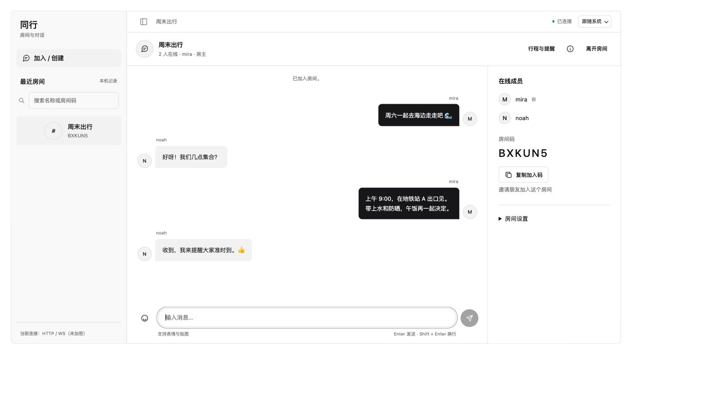
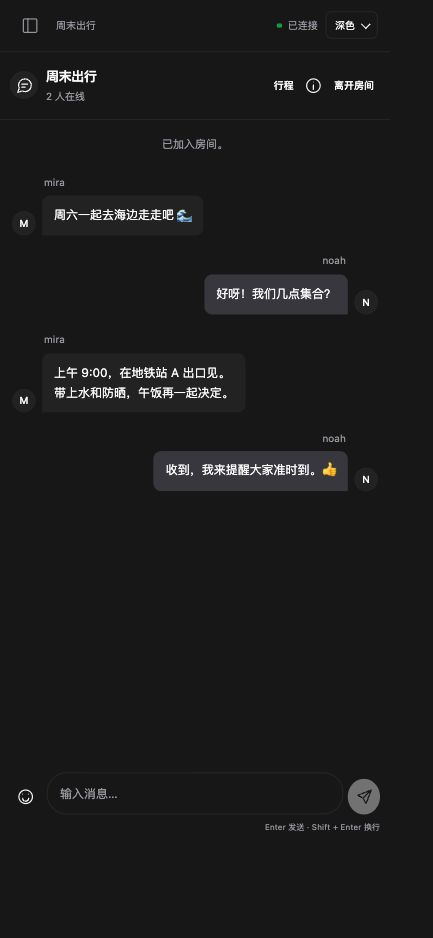
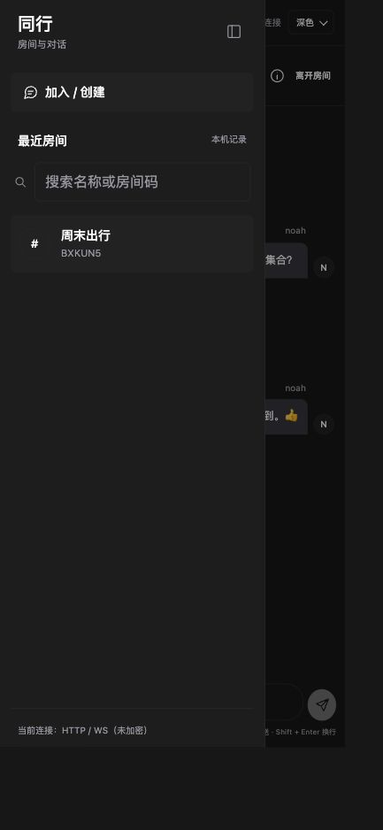

# 同行 · 临时聊天室

为一次出行、一场活动，创建一个临时的聊天空间。

**同行**是一个以 C11 为核心的 Web 聊天项目：通过房间码加入对话，在电脑和手机上实时交流，并可接入群聊助手、行程草稿与定时邮件提醒。聊天服务直接使用 Socket、`select` 和非阻塞 I/O，浏览器通过 WebSocket 连接，无需安装客户端。

[在线实例](https://43.129.182.26/) · [快速开始](#快速开始) · [部署与配置](docs/部署与配置.md) · [更新记录](docs/更新记录-2026-11-24.md)

> 在线实例采用账号与注册码登录。首次访问需要向实例维护者领取一次性注册码；本地基础预览无需注册。

## 界面预览



桌面端支持可折叠房间导航；收起后，聊天区与输入框自动加宽。房间信息、行程和提醒按需展开。

<p>
  
  
</p>

手机端默认收起导航，通过左上角按钮展开；界面支持浅色、深色与跟随系统。

截图来自真实运行的本地 HTTP/WS 演示，使用测试身份与示例聊天内容。公网账号模式使用 HTTPS/WSS；截图不包含线上用户的聊天记录。

## 核心功能

| 功能 | 说明 |
| --- | --- |
| 房间码入群 | 创建房间后分享 6 位加入码；支持在线成员列表、房主改名与关闭房间。 |
| 实时聊天 | 文本、Emoji 与内置贴图，同一房间内广播消息。 |
| 账号与邀请 | 一次性注册码注册，身份与账号绑定；同一账号重入房间时接管原连接。 |
| 临时记录 | 账号模式默认保留房间与消息 7 天，持久保存到 SQLite；较早消息可分批加载。 |
| 断线恢复 | 自动重连、恢复房间身份；断线期间保留当前页面未发送的草稿。 |
| 桌面与手机 | 可折叠侧栏、最近房间搜索、手机抽屉菜单，以及浅色/深色主题。 |
| HTTPS / WSS | 使用 OpenSSL 提供 TLS 传输，浏览器校验服务端证书。 |
| 群聊助手 | 配置模型后，`@群聊助手` 可基于本房间上下文回答问题。 |
| 行程与邮件 | 提取行程草稿，由房主编辑确认；支持行程提醒和按北京时间排期的重要通知。 |

AI 和邮件功能由可选的 Python 服务提供。基础 C 聊天服务可单独运行，不需要模型密钥、SMTP 或 Node.js。

## 快速开始

### 1. 获取源码与依赖

```sh
git clone https://github.com/MUST-Network-programming/temporary-room-chat.git
cd temporary-room-chat
```

需要 C11 编译器、CMake 3.20+、OpenSSL 3 和 SQLite3 开发库。

**macOS**（需已安装 Xcode Command Line Tools 和 Homebrew）：

```sh
brew install cmake openssl@3
cmake -S . -B build -DOPENSSL_ROOT_DIR="$(brew --prefix openssl@3)"
```

**Ubuntu / Debian**：

```sh
sudo apt update
sudo apt install -y build-essential cmake libssl-dev libsqlite3-dev
cmake -S . -B build
```

Windows 原生 MSVC / Winsock 构建见[部署与配置](docs/部署与配置.md#windows-原生构建)。

### 2. 启动基础聊天

```sh
cmake --build build -j2
./build/chat_server --anonymous-loopback --port 8080
```

打开 [http://127.0.0.1:8080](http://127.0.0.1:8080)，输入昵称并创建房间；另开一个标签页，使用不同昵称和房间码加入，即可互发消息。按 `Ctrl+C` 停止服务。

此模式仅绑定本机，房间与最近 100 条消息保存在内存，停止进程后清空。跨设备或公网访问请使用下方的 HTTPS 账号模式。

### 3. 可选：预览群聊助手、行程和本地邮件

在已完成 C 构建的项目目录中执行，需要 Python 3.10+ 与 `venv`：

```sh
python3 -m venv .venv
.venv/bin/pip install -r assistant/requirements-lock.txt
PUBLIC_BASE_URL=http://127.0.0.1:8090 ./scripts/preview-v2.sh
```

- [聊天与行程预览](http://127.0.0.1:8090)：使用固定演示回复和规则提取，无需 AI 密钥。
- [本地 SMTP 收件箱](http://127.0.0.1:8025)：使用 `@example.test` 测试地址查看实际捕获的邮件。

预览脚本仅向本地收件箱投递。真实 AI、外部邮件以及账号模式的配置见[部署与配置](docs/部署与配置.md)。

## 项目结构

```text
server/       C 网络事件循环、连接管理与收发队列
websocket/    WebSocket 握手、帧解析与消息处理
rooms/        房间、账号、身份与 SQLite 持久化
web/          浏览器界面与静态 HTTP 服务
tls/          OpenSSL 传输与本地证书工具
assistant/    群聊助手、行程、通知与邮件任务
scripts/      本地预览与现有云实例升级工具
tests/        协议、账号、持久化、邮件与界面检查
docs/         配置说明、协议文档与界面截图
vendor/       cJSON 与第三方许可
```

基础模式由 C 服务直接提供页面和 WebSocket。完整部署增加 Python 网关与独立任务进程，生产入口可通过 Nginx 提供同源 HTTPS/WSS。房间与身份由 C 服务管理，Python 服务验证成员权限后处理助手、行程和通知操作。

## 配置与部署

- **HTTPS 账号模式**：生成或配置服务器证书，使用 `--accounts` 指定账号库，并为参与者签发注册码。
- **真实 AI**：设置 `AI_MODE=openai` 以及兼容 Chat Completions 的接口地址、模型与 API 密钥。
- **真实邮件**：配置 SMTP，并显式启用 `ALLOW_EXTERNAL_EMAIL=1`；邮箱自助领取注册码由 `REGISTRATION_EMAIL` 单独控制。
- **云端升级**：仓库中的升级脚本针对项目现有的 Ubuntu/systemd 实例，包含编译、数据库备份、服务切换和失败恢复，不是通用的一键安装器。

完整参数、证书信任、Windows 构建和部署步骤见[部署与配置](docs/部署与配置.md)，可配置项见[环境变量示例](.env.example)。

## 数据与安全边界

- 账号模式的房间自创建起默认保留 7 天，重连不会续期；房主关闭或房间到期后清除房间及聊天记录。已发布的重要通知有独立的任务生命周期。
- 默认上限为 64 个 TCP 连接、16 个房间，单条正文最多 2048 个 UTF-8 字节；当前实现面向小规模活动。
- 密码保存为带随机盐的 PBKDF2-SHA256 校验值；登录令牌在服务重启后失效，需要重新登录。
- TLS 提供浏览器到服务器的传输加密，**不提供端到端加密**；服务器能读取聊天正文，启用 `--log-chat` 后会输出到服务端日志。
- 启用 AI 时，相关房间上下文会发送给配置的模型服务；邮件发送需要参与者主动绑定或订阅对应邮箱。
- SMTP 接受投递不等于保证进入收件箱；任务会区分已接受、失败与不确定状态。

## 验证

完成构建后，可以运行：

```sh
ctest --test-dir build --output-on-failure
python3 tests/integration.py
python3 tests/accounts.py
python3 tests/room_persistence.py
```

界面检查需要额外安装 `jsdom` 与 `ws`，它们仅用于开发验证，应用运行不依赖 Node.js：

```sh
npm install --no-save jsdom ws
node tests/ui-navigation.cjs
node tests/ui-register.cjs
```

邮件端到端检查可运行 `.venv/bin/python tests/bot_notices.py`。详细覆盖范围见测试脚本与[验证记录](docs/验收记录.md)。

## 文档与贡献

- [部署与配置](docs/部署与配置.md)
- [邮箱注册码与注册方式](docs/邮箱注册码.md)
- [更新记录](docs/更新记录-2026-11-24.md)
- [协议与设计说明](docs/协议与答辩.md)
- [界面实现说明](docs/UI改版说明.md)

欢迎通过 [Issues](https://github.com/MUST-Network-programming/temporary-room-chat/issues) 报告问题，或提交 Pull Request。提交时请说明改动目的、复现步骤或验证结果，并排除真实凭据、数据库和证书私钥。

## 致谢与许可

- 使用 [cJSON](https://github.com/DaveGamble/cJSON)，第三方许可见 [cJSON-LICENSE](vendor/cJSON-LICENSE)。
- 界面参考 [shadcn-chat](https://github.com/jakobhoeg/shadcn-chat)，相关许可见 [shadcn-chat-LICENSE](vendor/shadcn-chat-LICENSE)。
- OpenSSL 与 SQLite 作为外部依赖链接。本仓库当前未提供项目级 `LICENSE`，第三方许可不代表整个项目的使用授权。
